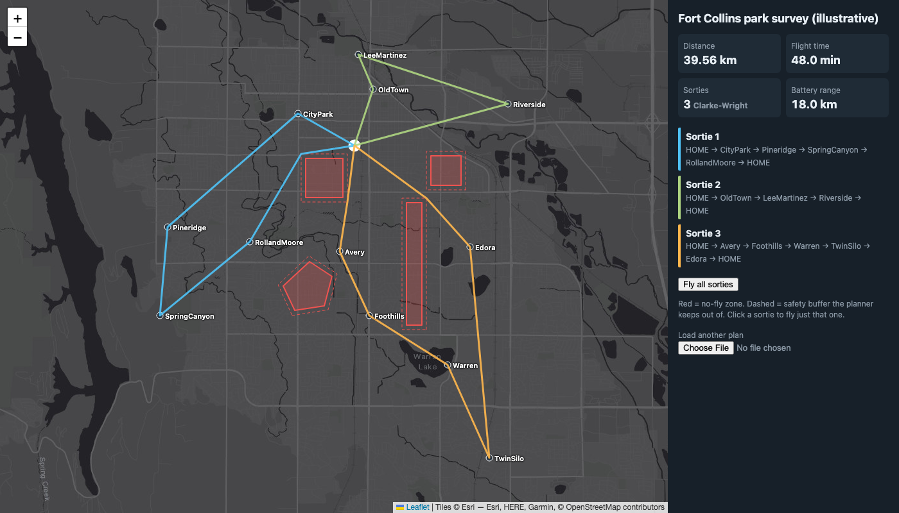

# UAV Mission Planner


Plans a multi-waypoint drone mission. It routes around buffered no-fly zones, finds a short visiting order for the waypoints, and splits the route into sorties that each fit one battery. The core is pure Python with no dependencies, plus a Leaflet map that animates the planned flight.



```
$ python -m uavplan examples/fort_collins.json
Mission: Fort Collins park survey (illustrative)
  12 waypoints, 4 no-fly zones (+100 m buffer), planned in 11 ms

  Sortie 1: HOME -> CityPark -> Pineridge -> SpringCanyon -> RollandMoore -> HOME
            13.52 km of 18.0 km range (75%)
  Sortie 2: HOME -> OldTown -> LeeMartinez -> Riverside -> HOME
            9.34 km of 18.0 km range (52%)
  Sortie 3: HOME -> Avery -> Foothills -> Warren -> TwinSilo -> Edora -> HOME
            16.70 km of 18.0 km range (93%)

  Total distance         39.56 km  (3 sorties, Clarke-Wright)
  Flight time             48.0 min at 15 m/s + 20 s loiter per waypoint
  If NFZs ignored        39.23 km  (avoidance costs 0.8%)

  Single loop (no battery limit)
    nearest neighbour    33.12 km
    2-opt + Or-opt       31.92 km  (3.6% shorter)
```

> The no-fly zones in the example are made up to exercise the planner. They are not real airspace restrictions.

## Quick start

```bash
python3 -m venv .venv && source .venv/bin/activate
pip install -e ".[dev]"

uavplan examples/fort_collins.json -o web/plan.geojson
python -m http.server -d web 8000      # open http://localhost:8000
pytest -v
```

## How it works

```
mission.json ─► project to local meters ─► inflate NFZs by safety buffer
                                                     │
                       visibility graph (convex corners + visible edges)
                                                     │
                 A* between every pair of stops ─► obstacle-aware distance matrix
                                                     │
                       ┌─────────────────────────────┴───────────────────────┐
                       ▼                                                     ▼
       NN → 2-opt → Or-opt single loop                       Clarke-Wright savings
       then cut into sorties (best start/direction)          (range-limited merges)
                       └───────────────► polish each sortie, keep shorter ◄──┘
                                                     │
                                          GeoJSON ─► Leaflet viewer
```

### 1. Local projection (`geo.py`)
All geometry happens in a flat east/north frame in meters, centered on home. Over the ~20 km a small UAV covers, an equirectangular projection is accurate to better than 0.1% (a test checks this against haversine). Straight lines stay straight, so the geometry code stays exact and simple.

### 2. No-fly zones and safety buffers (`geometry.py`)
Each zone is **inflated** by the safety buffer. Every edge is pushed outward by exactly *d*, and neighboring edges are joined at a mitered corner. A path segment is rejected if it **crosses** an edge of an inflated zone, or if its midpoint is strictly inside one. The midpoint check catches a segment that cuts straight between two corners without crossing any edge. Touching a corner or sliding along an edge is allowed, so paths can hug the buffer.

### 3. Shortest paths: visibility graph + A* (`pathfind.py`)
The shortest path around polygon obstacles is a polyline that bends only at the obstacles' **convex corners**. So instead of a grid, which gives jagged and longer paths that depend on cell size, the planner builds a graph:
- **nodes** are the convex corners of every inflated zone, pushed 0.5 m further out;
- **edges** connect every pair of nodes that can "see" each other (the segment between them hits no zone).

Corner-to-corner visibility is computed once. Each query adds only the start and goal, then runs **A*** with straight-line distance as the heuristic. That heuristic never overestimates, so the result is optimal.

### 4. Ordering waypoints: TSP heuristics (`tour.py`)
With an all-pairs matrix of real flight distances, ordering the waypoints is a Travelling Salesman Problem. Exact solutions take exponential time, so the planner:
1. builds a **nearest-neighbour** tour (greedy, O(n²));
2. applies **2-opt**: if reversing a section of the tour shortens it, reverse it. This removes every self-crossing;
3. applies **Or-opt**: move a chain of 1–3 consecutive stops, in either orientation, to its best position elsewhere;
4. repeats 2 and 3 until neither improves.

Tests compare the result with brute-force optimal tours on 25 random 8-stop instances, and require it to be within 2%.

### 5. Battery limits: sorties (`sorties.py`)
If the whole loop doesn't fit in one battery, the planner builds multi-sortie plans two ways and keeps the shorter:
- **Route-first, cluster-second.** Cut the optimized loop into sorties greedily. Before each next stop, check that the aircraft can reach it *and still get home*. All starting points and both directions are tried.
- **Clarke-Wright savings.** Start with one out-and-back sortie per stop. Merging the sortie that ends at *i* with the one that starts at *j* saves `d(i,home) + d(home,j) − d(i,j)`. Merges are applied from largest saving down, whenever the result still fits the range.

Each resulting sortie's stop order is then re-optimized on its own. On the example mission, Clarke-Wright wins: 39.6 km, against 42.3 km for naively cutting the loop.

A waypoint whose round trip alone exceeds the battery range makes the mission infeasible, and the error names that waypoint.

### 6. Viewer (`web/index.html`)
Leaflet renders the GeoJSON output:
- no-fly zones, with their buffers dashed;
- each sortie in its own color;
- an animated drone that flies all sorties, or just the one you click.

## Mission file format

```json
{
  "name": "Example",
  "home": {"lat": 40.5765, "lon": -105.0810},
  "uav": {"cruise_speed_mps": 15, "max_range_m": 18000, "loiter_s": 20},
  "safety_buffer_m": 100,
  "waypoints": [{"id": "WP1", "lat": 40.583, "lon": -105.096}],
  "no_fly_zones": [{"name": "Zone A", "polygon": [[40.566, -105.094], [40.574, -105.094], [40.574, -105.084]]}]
}
```

## Design decisions

| Decision | Why |
|---|---|
| Visibility graph instead of grid A* | Optimal any-angle paths, no resolution tuning, and far fewer nodes (about 4 per zone instead of thousands of cells). |
| Only convex corners as nodes | A shortest path never bends at a concave corner, so those nodes can be dropped. |
| All-pairs paths up front | O(n²) A* queries turn a geometric problem into a plain distance matrix, so every TSP/VRP heuristic works unchanged. |
| Run two sortie strategies and keep the better | Neither strategy always wins. Both are cheap, so trying both is simpler than predicting which one will. |
| Equirectangular projection | Exact straight-line geometry. The error is far below the size of the safety buffer at this scale. |
| No dependencies | Every algorithm is visible and tested in this repo. |

## Testing

`pytest` runs 107 tests, including:
- geometry predicates, including concave polygons and edge-touching cases
- mitered inflation keeping edges exactly *d* away
- A* paths that are provably optimal around a square, that thread a gap until a buffer closes it, and that fail correctly when the goal is fully enclosed
- tour quality against brute force on random instances
- each optimization stage never making the tour worse
- every sortie strategy respecting battery range and visiting every stop exactly once, across 45 random scenarios
- end to end: no flown leg on the example mission enters a no-fly zone

## Roadmap
- [ ] Wind: make leg cost depend on heading (an asymmetric matrix, so 2-opt needs a directed variant)
- [ ] Terrain and altitude limits from a DEM (3-D keep-out volumes)
- [ ] Time windows per waypoint (VRPTW)
- [ ] Multiple drones launching from different bases
- [ ] Export to MAVLink mission format for ArduPilot/PX4 SITL
- [ ] Port the hot loops (visibility, 2-opt) to C++ and benchmark

## License
MIT
